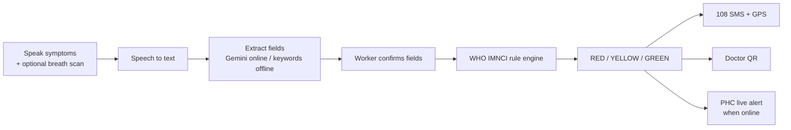

# CareTriage

**Voice-first, offline-capable triage for community health workers.**

> Concept stage: this repo describes the planned design. Code is coming.

## Problem

Community health workers (ASHA, ANM) are often the first point of care in a village, but their tools are slow and need connectivity. Reporting by [Newlines](https://newlinesmag.com/reportage/indias-digital-health-push-is-overworking-its-front-line-women/) describes health apps that take 20 to 30 minutes per person on low-end phones and log workers off with no save, losing their entries. Danger signs get recognised late.

## Solution

A mobile web app (PWA) where the worker **speaks symptoms in Tamil, Hindi or English**, optionally records a **5-second breath sample**, and gets a full-screen **RED / YELLOW / GREEN** result with one clear action.

- **AI reads, rules decide.** AI only extracts fields from speech. The tier comes from deterministic WHO IMNCI rules.
- **Same rules on the phone.** A shared `rules.json` runs in TypeScript on the device, so triage works offline.
- **Doctor QR report.** The result screen shows a QR that carries a compact case summary for the doctor.

| Tier | Action |
|------|--------|
| RED | Call 108 now, one-tap SMS with GPS |
| YELLOW | Refer to the PHC within 24 hours |
| GREEN | Home care, re-check if danger signs appear |

## How it works



## Architecture

**Frontend (shared):** React, TypeScript, Vite, Tailwind CSS, `vite-plugin-pwa` (Workbox), Web Audio API (noise check, breath recording), Speech Synthesis plus pre-recorded Tamil and Hindi clips, Geolocation and a pre-filled `sms:` link.

**Online mode**

- Node.js (Express, WebSocket) gateway: receives audio, calls Indic speech-to-text, forwards to the core, pushes RED alerts to the PHC doctor view
- FastAPI, SQLModel, SQLite: clinical core and database
- Gemini API with Pydantic structured output: transcript to strict JSON
- YAMNet: wheeze flag from the breath sample, as supporting evidence only
- Pure Python rule engine

**Offline mode**

- TypeScript rule engine reading the same `rules.json`
- Local extractor: regex and keyword dictionaries for English, Tamil and Hindi, plus a tap checklist of danger signs
- IndexedDB (`idb`) for rules, saved cases and a sync queue
- Service worker caching the app, audio clips and rules

**One source of truth:** both engines read one `rules.json` and run the same shared test cases, so online and offline always give the same tier.

### Offline support

| Capability | Offline |
|------------|---------|
| Triage rules, typed and tap input, saved cases | Yes |
| Spoken instructions | Yes (pre-recorded clips) |
| Doctor QR | Yes |
| Voice input | Usually needs a connection (browser speech sends audio to the cloud). Offline falls back to typed and tap input; an on-device model such as Vosk is a later experiment |
| Breath scan | Online first |
| 108 SMS | Needs cell signal, not internet |

### Doctor QR report

The QR carries the report itself, not a link, so it is generated on the phone and scanned with any camera app with no internet on either side. It holds a short anonymous summary (a QR fits about 3 KB at most); full records sync later.

```json
{ "v": 1, "t": "2026-10-23T09:42:00+05:30", "age_m": 18, "signs": ["fever_3d", "fast_breathing"],
  "rr": 52, "tier": "RED", "rule": "IMNCI-PNEUMONIA-SEVERE", "breath": "wheeze_possible" }
```

Any scanner shows it as plain text. A cached viewer page formats it, and works offline once opened once while online.

### Repository layout (planned)

```
caretriage/
├── rules/            # rules.json + shared test cases (single source of truth)
├── app/              # React + TypeScript + Vite PWA
│   ├── src/engine/   # TypeScript rule engine
│   ├── src/extract/  # offline extractor (EN / TA / HI)
│   ├── src/qr/       # QR payload + generator
│   └── public/audio/ # pre-recorded Tamil and Hindi clips
├── server/
│   ├── gateway/      # Node.js + Express + WebSocket
│   └── core/         # FastAPI + Python rule engine + SQLite
├── viewer/           # cached doctor QR viewer page
└── docs/             # architecture notes, API contract
```

### Risks and mitigations

| Risk | Mitigation |
|------|------------|
| Offline voice recognition is weak | Typed and tap fallback now, on-device model later |
| Tamil and Hindi accuracy varies by provider | Test providers on real samples; worker confirms extracted fields |
| Extractor misses negation ("no headache") | Worker confirmation step, larger parser test set |
| Wheeze detection is unproven | Supporting evidence only, never overrides rules |
| 108 is a voice line and may not accept SMS | Configurable dispatch or PHC number, confirmed before field use |
| QR capacity is limited | Short anonymous summary; full records sync later |
| Rule correctness | One shared rules file, shared tests, clinician review |

### Safety

- Only the rule engine sets the tier. The worker confirms every extracted field first.
- The breath scan never overrides the rules.
- SMS is pre-filled for one tap, since browsers cannot send silently. The dispatch number is configurable and confirmed first.
- Rules need clinician review before any field use. This is not a validated medical device.

## Business

- **Users:** ASHA and ANM workers, sub-centres and PHCs.
- **Customers:** state health departments, NHM programmes and NGOs.
- **Differentiation:** many digital health tools are form-based and need typing and connectivity. CareTriage adds Tamil and Hindi voice, offline rules and SMS escalation.
- **Model:** open-source core, with paid hosting, support and training.
- **Costs:** static PWA hosting, a small API server, pay-per-use speech and LLM calls.
- **Next needs:** clinician review of the rules, a field pilot with a PHC, and Tamil and Hindi voice testing.
